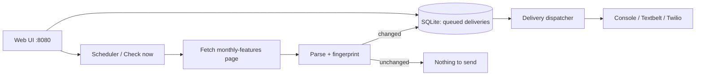

# Bin4Scraper

Checks the [Bin 4 Burger Lounge monthly features](https://bin4burgerlounge.com/monthly-features/) page on a schedule and texts the new feature burger to a list of people **when it changes**. It runs as a single Docker container on a home server such as Unraid and includes a small web UI.

- **Web UI** shows the current feature and lets you check now, preview, send the latest feature to everyone, manage recipients, send test SMS, view history and resend messages.
- **Scheduler** runs a daily check by default. The app catches up after downtime, retries failed checks, and can text an admin after repeated failures.
- **SMS providers:** `Console` is the default dry run that only writes messages to the log. `Textbelt` and `Twilio` send real texts.
- **Storage** uses one SQLite file in `/data`. Recipients, checks, deliveries, raw page snapshots and UI keys are stored there.
- **CLI** commands let you test scraping and SMS from a terminal or `docker exec` without the UI.



Messages are queued in the database before they are sent. If the container restarts mid-send, the remaining messages still go out. If a provider times out, the message is marked `unknown` and is **not** retried automatically, which avoids double texts. You can resend it from History.

A change means a new feature title or a new item name. Price or description edits do not re-text everyone.

---

## Configuration

Settings come from `appsettings.json` and can be overridden with environment variables. Use a double underscore (`__`) as the section separator.

| Variable | Default | Description |
|---|---|---|
| `Sms__Provider` | `Console` | `Console` (dry run), `Textbelt` or `Twilio` |
| `Sms__Textbelt__Key` | | [Textbelt](https://textbelt.com) API key |
| `Sms__Textbelt__TestMode` | `false` | `true` makes Textbelt validate the request and key **without sending or using quota** |
| `Sms__Twilio__AccountSid` / `__AuthToken` / `__From` | | Twilio credentials and sending number (`+1...`) |
| `Sms__AdminPhone` | | Optional number texted when checks fail repeatedly |
| `Sms__FailureAlertThreshold` | `3` | Consecutive failed checks before the admin alert |
| `Sms__DefaultCountryCode` | `1` | Prefix used for 10-digit numbers |
| `Sms__MaxAttempts` | `3` | Attempts for definite failures, such as rejected requests |
| `Scraper__Categories` | `Burger` | Comma-separated categories to text, such as `Burger,Dessert`, or `*` for all |
| `Scraper__Schedule` | `0 9 * * *` | Cron schedule (minute hour day month weekday) |
| `Scraper__TimeZone` | `America/Vancouver` | Time zone for the schedule |
| `Scraper__NotifyOnFirstRun` | `true` | Whether the very first successful check texts recipients |
| `Scraper__Enabled` | `true` | `false` disables scheduled checks; manual checks still work |
| `Storage__DataDirectory` | `data` (`/data` in Docker) | Where the database and snapshots live |
| `Ui__Password` | | Set this to require HTTP Basic login for the UI. `/healthz` stays open |
| `Ui__Username` | `admin` | Login username when a password is set |
| `TZ` | `America/Vancouver` (Docker) | Container time zone for log timestamps |

---

## Run locally (no Docker)

You need the [.NET 10 SDK](https://dotnet.microsoft.com/download).

```powershell
dotnet test                              # run the unit tests
dotnet run --project src/Bin4Scraper     # start the app, then open http://localhost:8080
```

The app uses the `Console` provider by default, so nothing is texted until you configure a real provider. Data is stored in a local `data/` folder, which git ignores.

### Store SMS credentials locally (user-secrets)

Keep keys out of the repository with .NET user-secrets:

```powershell
cd src/Bin4Scraper
dotnet user-secrets set "Sms:Provider" "Textbelt"
dotnet user-secrets set "Sms:Textbelt:Key" "<your key>"
# or Twilio:
dotnet user-secrets set "Sms:Provider" "Twilio"
dotnet user-secrets set "Sms:Twilio:AccountSid" "AC..."
dotnet user-secrets set "Sms:Twilio:AuthToken" "<token>"
dotnet user-secrets set "Sms:Twilio:From" "+1XXXXXXXXXX"
```

User-secrets are only loaded when the app runs in the Development environment. `dotnet run` uses Development by default.

### Test SMS from your computer

Use the UI at **http://localhost:8080/Test**, or use the CLI:

```powershell
# Show what would be texted (fetches the live page; saves/sends nothing)
dotnet run --project src/Bin4Scraper -- check

# Dry run through the Console provider (prints the SMS)
dotnet run --project src/Bin4Scraper -- send-test --to 250-555-1234 --Sms:Provider=Console

# Validate your Textbelt key without sending or spending quota
dotnet run --project src/Bin4Scraper -- send-test --to 2505551234 --Sms:Textbelt:TestMode=true

# Send a real text with the configured provider
dotnet run --project src/Bin4Scraper -- send-test --to 2505551234
dotnet run --project src/Bin4Scraper -- send-test --to 2505551234 --feature   # send the live feature text

# Run a real check: records it and texts recipients if the feature changed
dotnet run --project src/Bin4Scraper -- check --notify
```

Any `--Section:Key=value` argument overrides a setting for that run. `send-test` exits with code `0` on success and `1` on failure. Every send is recorded in History.

### Run locally in Docker

```powershell
copy .env.example .env      # then edit .env (never commit it)
docker compose up --build   # open http://localhost:8080
docker compose exec bin4scraper dotnet Bin4Scraper.dll send-test --to 2505551234
docker compose exec bin4scraper dotnet Bin4Scraper.dll check
```

---

## Container image (GitHub Actions)

`.github/workflows/docker.yml` runs the tests and builds the image for every push and pull request. It publishes to the GitHub Container Registry for pushes to `master` and `v*` tags:

| Tag | When |
|---|---|
| `ghcr.io/jsyro/bin4scraper:latest` | every push to `master` |
| `ghcr.io/jsyro/bin4scraper:sha-abc1234` | every push (pin a specific build) |
| `ghcr.io/jsyro/bin4scraper:1.2.3`, `:1.2` | pushing a tag such as `v1.2.3` |

Pull requests build the image without publishing it. You can also start the workflow manually from the **Actions** tab.

**Make the package pullable by Unraid.** New GHCR packages are private by default. After the first successful run, choose one of these:

- **Public (simplest):** GitHub → your profile → **Packages** → `bin4scraper` → **Package settings** → **Change visibility** → Public. The image contains no secrets because all keys are supplied at runtime.
- **Private:** create a [personal access token (classic)](https://github.com/settings/tokens) with only `read:packages`. Then run this once in the Unraid terminal:
  `docker login ghcr.io -u Jsyro` (paste the token as the password).

---

## Host on Unraid

### 1. Create the appdata folder

The container runs as Unraid's standard `nobody:users` (`99:100`) user, so the data folder must be writable by that user. If you skip this step, Docker creates it as root and the app will exit with a clear permission error. Open **Terminal** (top-right `>_` icon) and run:

```bash
mkdir -p /mnt/user/appdata/bin4scraper
chown -R 99:100 /mnt/user/appdata/bin4scraper
```

### 2. Add the container

**Option A: Template (recommended).** In the Unraid terminal, run:

```bash
wget -O /boot/config/plugins/dockerMan/templates-user/my-bin4scraper.xml \
  https://raw.githubusercontent.com/Jsyro/bin4scraper/master/unraid/bin4scraper.xml
```

Then go to **Docker → Add Container**, select **bin4scraper** from the **Template** dropdown, fill in the fields and click **Apply**.

**Option B: Manual.** Go to **Docker → Add Container** and enter:

| Field | Value |
|---|---|
| Name | `bin4scraper` |
| Repository | `ghcr.io/jsyro/bin4scraper:latest` |
| Network Type | `bridge` |
| WebUI | `http://[IP]:[PORT:8080]/` |
| Extra Parameters (Advanced View) | `--user 99:100` |
| Port | Container `8080` → Host `8080` (choose another host port if 8080 is taken) |
| Path | Container `/data` → Host `/mnt/user/appdata/bin4scraper` |
| Variables | `Sms__Provider`, `Sms__Textbelt__Key`, and the other settings from the [Configuration](#configuration) table |

Use **Add another Path, Port, Variable…** for each entry. Mark keys and passwords as masked.

**Tip:** Start with `Sms__Provider=Console` or `Sms__Textbelt__TestMode=true`. Switch to real sending after everything looks right.

### 3. Open the UI

Open `http://<unraid-ip>:8080` from any device on your network. You can also click the container icon and choose **WebUI**.

1. **Recipients:** add people. Numbers like `250-555-1234` are normalized to `+12505551234`.
2. **Send test:** send yourself a message. The result and any provider error are shown immediately.
3. **Dashboard → Check now:** confirm the live page parses.
4. **Dashboard → Send latest to all:** text everyone the current feature. Use this after first setup, because scheduled checks only text when the feature *changes*.

### 4. Test SMS from the Unraid terminal

```bash
docker exec bin4scraper dotnet Bin4Scraper.dll check
docker exec bin4scraper dotnet Bin4Scraper.dll send-test --to 2505551234
docker exec bin4scraper dotnet Bin4Scraper.dll send-test --to 2505551234 --Sms:Textbelt:TestMode=true
docker exec bin4scraper dotnet Bin4Scraper.dll send-test --to 2505551234 --feature
```

The CLI uses the container's configuration and database, so its sends also appear in History.

### 5. Operate

- **Logs:** click the container icon and choose **Logs**, or run `docker logs -f bin4scraper`.
- **Health:** the container reports `healthy` or `unhealthy` on the Docker tab. `http://<unraid-ip>:8080/healthz` returns JSON with the last check status and failure count.
- **Update:** after a push to `master`, click **Check for Updates** on the Docker tab, then **apply update**. The data in `/mnt/user/appdata/bin4scraper` is kept.
- **Backup:** open `http://<unraid-ip>:8080/backup` to download a consistent copy of the database. The **Appdata Backup** plugin also covers `/mnt/user/appdata/bin4scraper`.
- **Change settings:** click the container icon, choose **Edit**, change the variables, then click **Apply**. The container is recreated, and recipients and history are kept.

### Security

The UI can send texts that cost money, so keep it on your LAN or reach it through a VPN such as Unraid's WireGuard or Tailscale. Do not port-forward it to the internet. Set `Ui__Password` if others use your network.

---

## Troubleshooting

| Symptom | Fix |
|---|---|
| Container stops immediately, and the log says `Data directory '/data' is not writable` | Run `chown -R 99:100 /mnt/user/appdata/bin4scraper` and confirm Extra Parameters has `--user 99:100` |
| `denied` / `unauthorized` pulling the image | Make the GHCR package public, or run `docker login ghcr.io` on Unraid ([details](#container-image-github-actions)) |
| Checks fail with "Could not find…" or "no feature items" | The restaurant changed its site. The raw HTML of every check is saved in `/data/snapshots` so you can update `FeatureParser` and add a test fixture |
| Nothing was texted after setup | Scheduled checks only text when the feature changes. Use **Send latest to all** |
| Textbelt `Out of quota` | Your key has no credit left. The free `textbelt` key allows about one text per day |
| Twilio error 21608 / 21610 / 30034 | Trial accounts can only text verified numbers. US numbers require A2P 10DLC registration, and the recipient may have replied STOP |
| A message shows `unknown` | The provider timed out, so it may or may not have arrived. Check with the recipient before using **Resend** |
| Wrong check time | Set `Scraper__TimeZone` (schedule) and `TZ` (logs) |

## Project layout

```
src/Bin4Scraper/        ASP.NET Core app (Razor Pages UI, scheduler, CLI)
  Scraping/             page fetch + AngleSharp parser + SMS formatting
  Sms/                  Console / Textbelt / Twilio senders
  Services/             check, delivery and scheduler services
  Data/                 SQLite schema + queries (Dapper)
tests/Bin4Scraper.Tests xUnit tests (parser fixture, phone numbers, change detection)
unraid/                 Unraid Docker template
Dockerfile, docker-compose.yml, .github/workflows/docker.yml
```
